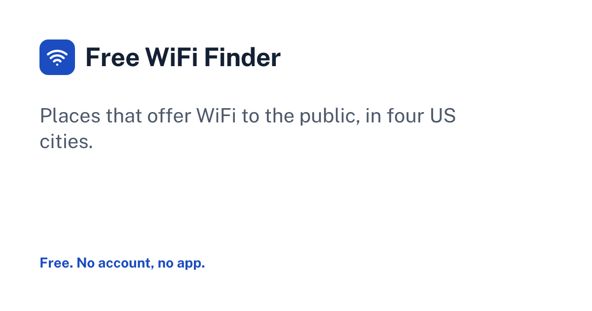

# Free WiFi Finder

A free finder for places that offer WiFi to the public, such as cafes, libraries and restaurants, in four US cities. No app, no account.



## What it does

- **City pages** for Austin, Chicago, San Francisco and Seattle: the list is the answer, the map is context.
- **Free first:** places tagged free for everyone come first, then customers only, then ask staff, each with a "checked" date when the data has one.
- **Map and list stay in sync:** select a place and the map opens its card; markers use shapes as well as colors (circle, square, diamond), so status is never shown by color alone.
- **Near me:** sorts by distance in the browser; the location is never sent anywhere.
- **Filters** by name, type of place and who can use it, kept in the URL so a view can be shared.
- **Policy-safe by design:** only venues open to the public. No home networks and no passwords.

## Data

Data comes from OpenStreetMap through the Overpass API (`scripts/fetch-wifi.mjs`), with an inclusion rule that drops private, residential, office, school and closed places. Sorting has a self-check: `node --experimental-strip-types src/components/wifi/sort.check.ts`.

Place data © OpenStreetMap contributors, available under the [Open Database License](https://www.openstreetmap.org/copyright). The map uses Leaflet and OpenStreetMap tiles; a commercial launch would need a tile provider that allows it.

## Quality bar

- WCAG 2.1 AA: contrast checked on every color pair in light and dark mode, visible focus, labeled inputs, 44px touch targets and reduced motion
- Responsive from 320px to wide desktop with no sideways scrolling
- Every state is designed: empty, loading, zero results, errors, and no JavaScript
- SEO: semantic headings, canonical URLs, structured data, a sitemap and Open Graph images

## Stack

- [Astro 7](https://astro.build) with static output, plain TypeScript and plain CSS (no UI framework)
- One design system: tokens in `src/styles/tokens.css`, a component kit in `src/components/ui/`, and Public Sans served through Astro's Fonts API
- A logo drawn for this product, with the three concepts it was chosen from, in [`docs/brand/`](docs/brand/)
- Inline SVG icons from [Lucide](https://lucide.dev) (ISC)
- No tracking and no accounts; anything saved stays in the visitor's browser

## Run it

```bash
pnpm install
pnpm dev          # http://localhost:4321
pnpm astro check  # types
pnpm build        # static site in dist/
```

## Status

A working prototype. Before a public launch, fill in the fields marked `OWNER TO FILL` in `src/site.ts` (name, domain, contact and host), then set `prototypeNotices` to `false`. The build fails while a required field is empty.

## License

No license: © 2026 Maria Eduarda, all rights reserved. You're welcome to read the code; please ask before reusing it.
