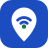
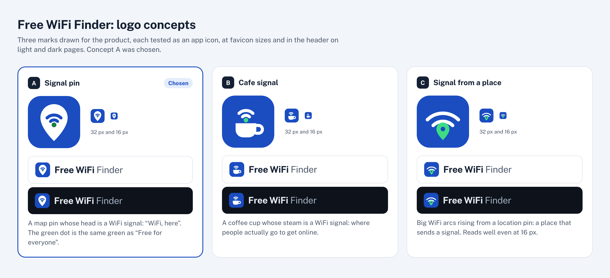

# Logo

A map pin whose head is a WiFi signal: “WiFi, here”. The green dot is the green of the “Free for everyone” map markers.

| Part | Color |
|---|---|
| Tile and signal | `#1B4DC1` (`--action`) |
| Pin | `#FFFFFF` (`--on-action`) |
| Dot | `#1E7A46` (`--good-fill`) |

Token names refer to `src/styles/tokens.css`.

## Using it

- The tile keeps its colors on light and dark pages. On dark pages the site adds a 1px edge (`--line-strong`) so the tile does not blend into the background.
- It stays legible down to 16px, the favicon size.
- Next to the mark, the name is set in Public Sans: **Free WiFi** in bold (700), then Finder in regular (400) and the muted text color (`--muted`).
- The mark lives in four places that change together: `markSvg()` in `src/components/ui/icons.ts`, `public/favicon.svg`, `scripts/og/og.html` (the source of the share image and the touch icon) and `logo.svg` here.

## How it was chosen

Three concepts were drawn and tested as an app icon, at 32px and 16px, and in the header on light and dark pages. Concept A was chosen. Each one is also an SVG here: `concept-A.svg`, `concept-B.svg` and `concept-C.svg`.

